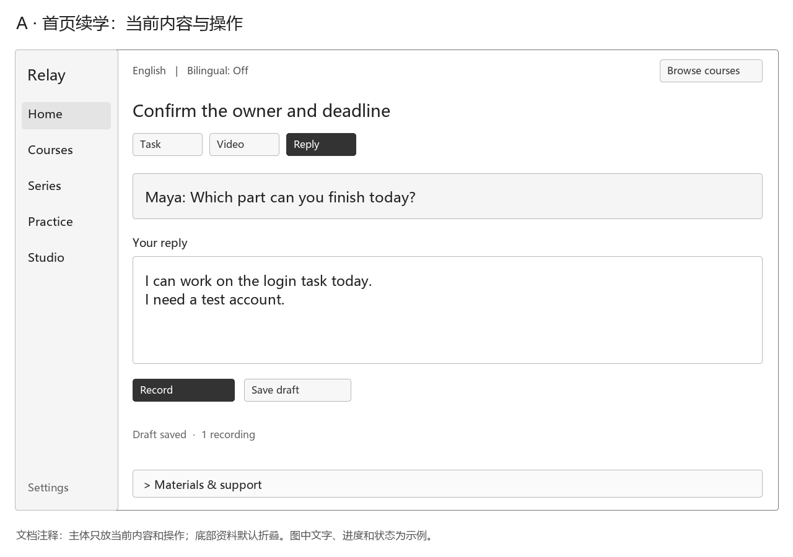
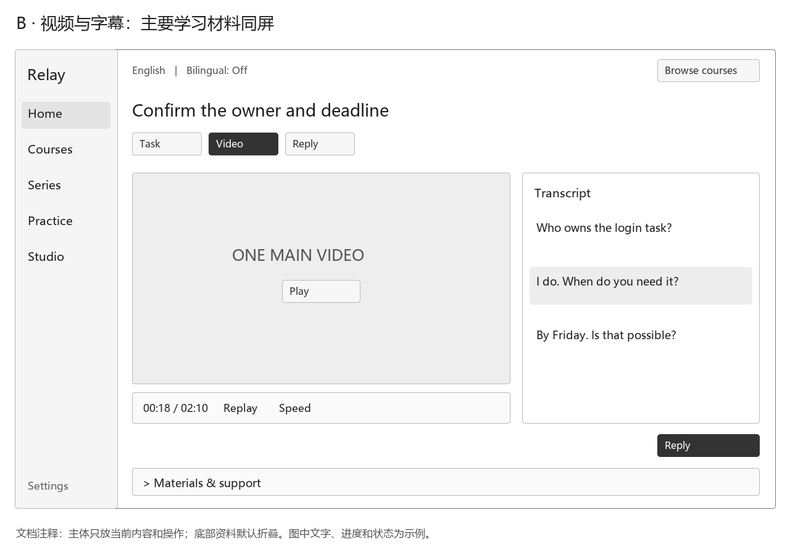
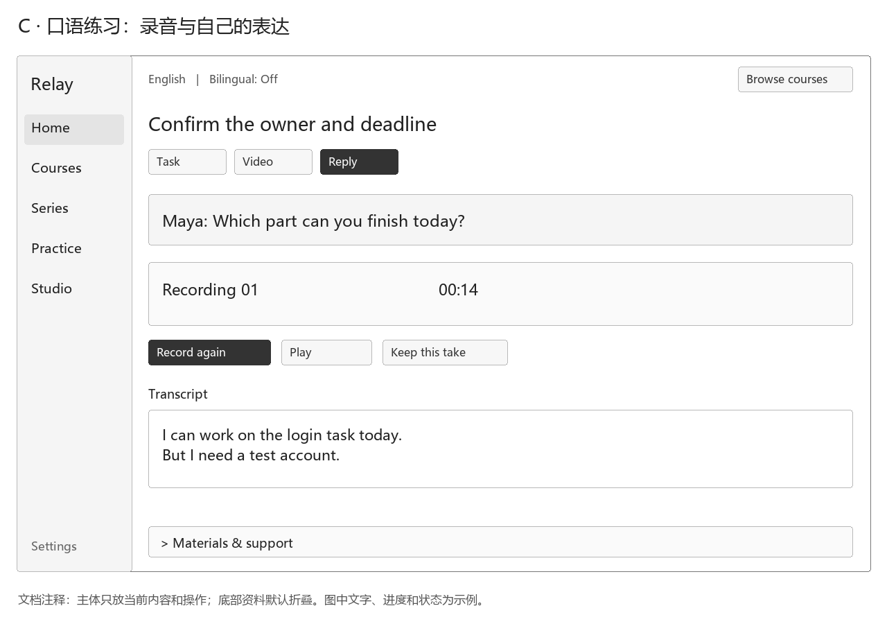
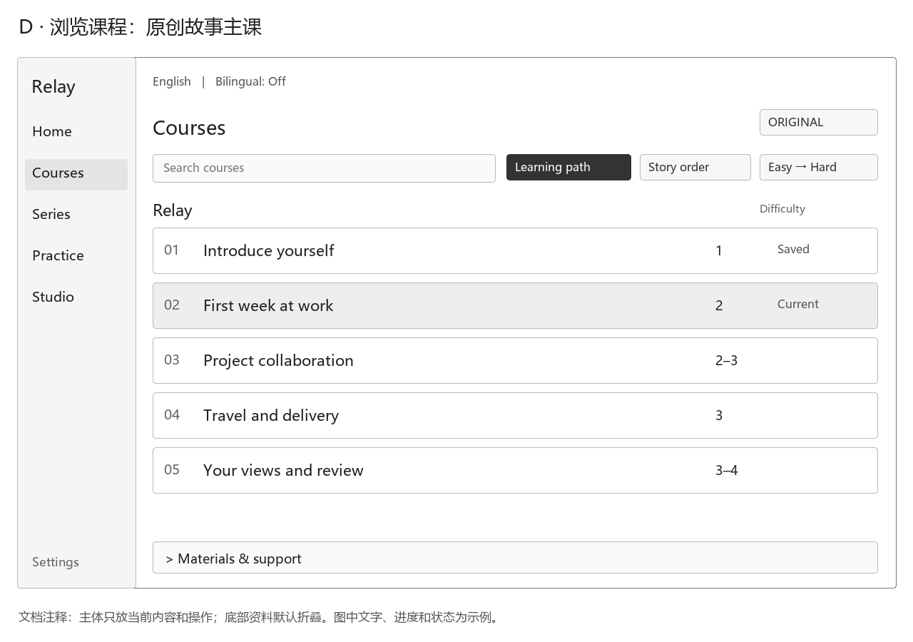
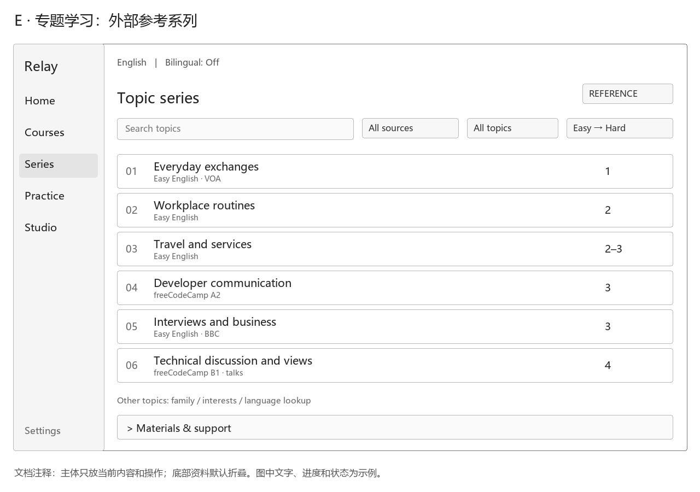
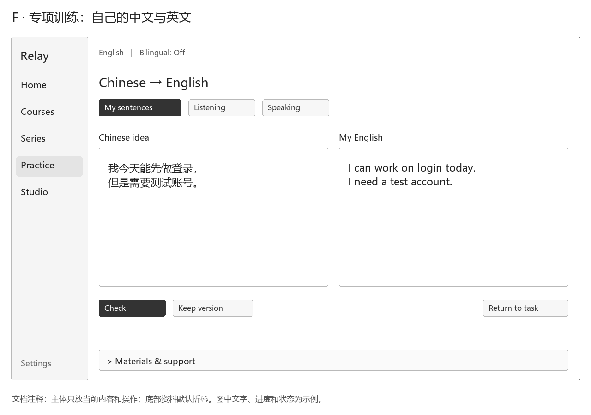
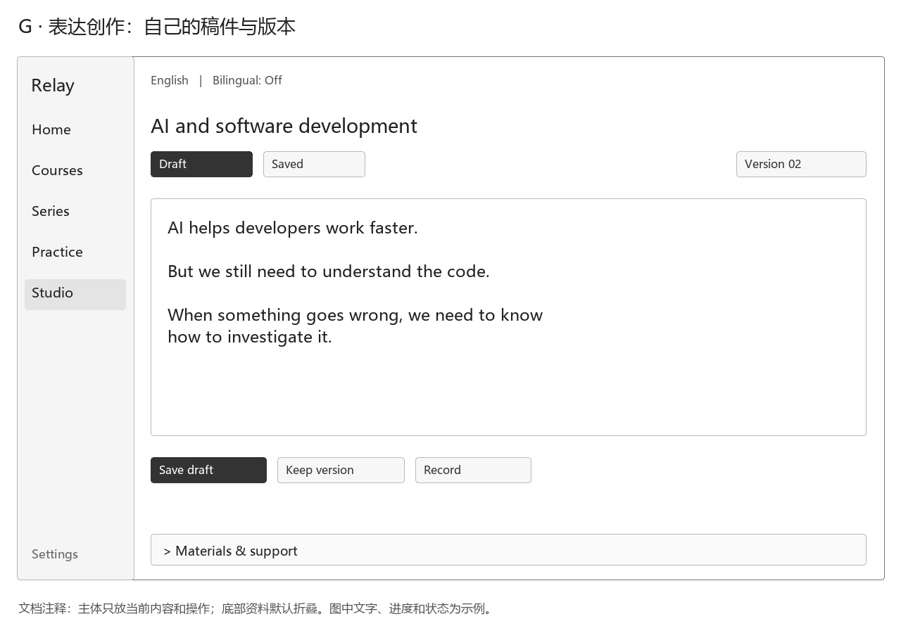

# 个人语言学习与表达网站

本文记录用户明确的产品目标，并给出待确认的组织与交互建议。依据为本次对话：用户为中文母语、40 岁的程序员，希望学习英语用于交流，并将自己的观点用英文输出成视频；站点需支持多语言，优先英语、其次德语，默认显示学习语言，可勾选双语模式，并链接外语参考资料。

当前无产品实现。本文的验收条件是后续实现的目标，不是已运行的测试结果。

## 1. 定位与目标

定位为面向成年人的个人语言学习与表达工作台。用户已明确仅供本人使用，不对外开放；学习内容需要成体系，主要围绕职场、技术和生活化交流。学习成果应能用于对话和口头表达，并逐步支持观点视频的内容准备。

“成体系”是已确认的选型要求，不能只凭词汇量、练习数量或支持自由聊天来判定符合需求。具体分级、课程顺序、掌握标准和反馈机制尚待确定；建议结合真实沟通任务组织递进课程，避免把成人学习等同于商务词汇集合。

用户进一步明确“干中学”：从头跟进一个项目，由助手带着完成一遍，用连续故事或具体对象串联模拟的工作与生活。课程中的场景应推进同一项目，不能只是一组互不相干的高频小课。词汇随任务理解和使用，不设置独立背词模块；按发生概率与实用性收窄范围，专项围绕中文表达转英文句子及当前卡点；参考专题不自动成为多套必修课程。

用户要求把介绍自己、面试、项目、沟通、出差等推进为 365 个常见场景并串成一条故事线，并明确每项必须是完整场景，不能把孤立动作或练习拆开凑数。逐项场景卡见[365 场景故事线](365场景故事线.md)，每项列触发、交流过程、结果和视频状态；具体项目、角色与地点是编写建议。365 不表示每天一课或已完成 365 篇英语教材。

外部教材与 YouTube、B 站资源用于研究场景、语言难度和教学组织，也可以作为场景中的学习输入。用户后续会要求助手据此原创编写适合本人的教材与连续故事；最终学习主线以原创故事为主，不要求逐课学习外部课程。**每个场景只嵌入 1 个最合适的主视频，其余作为参考链接；可下载资料保留来源方正式下载入口。** Easy English 是用户明确提出的研究来源。当前交付大纲与候选资料，不自动启动完整教材编写或播放器实现。用户进一步确认可分原创课程与不同内容的参考专题系列。原创Relay主课保持连贯，外部材料可独立浏览并按难度择用；具体排序为编排建议，见[课程规划的系列排序](课程与练习规划.md#26-原创主课与参考专题的系列排序)。

参考收集优先取得国外出版社较新的英文原版完整教材，贴近成人职场／技术／生活场景；样章保留完整目录、主题与能力点供后续使用，并标明尚未取得全书。出版、修订和文件上传日期分别核验，完整正文与音视频、互动练习分别记录。收集与提炼结果见[原版教材知识库](10学习资料/原版教材知识库.md)和[场景与题型参考库](10学习资料/场景与题型参考库.md)。

用户希望尽快把观点表达出来，因此课程组织需要与实际输出连接：每次学习都有明确的表达对象，例如介绍自己、解释技术选择、澄清需求或谈论一个 AI 观点。速度是产品目标，目前没有已确认的学习时长、达成期限或效果指标，不承诺固定时间内达到流利水平。

用户已确认：**首页直接继续当前这一课，同时保留浏览课程的入口。** 页面围绕当前表达任务展开；菜单与课内布局的讨论方案见[全站页面布局](#63-全站页面布局讨论稿)。具体控件、恢复粒度与口语服务尚未确认，不视为已经实现或获准编码。

## 2. 用户与角色

已明确的主要用户是站点所有者本人，中文母语，40 岁，程序员。网站的内容和视觉应适合成年人的生活与工作背景。

用户已明确英语需要从基本词句开始。课程起点按基础词句与简单交流设计，不据此推定已经通过或未通过某个 CEFR 等级；德语水平、可投入时间仍未明确。现阶段不把公开社区、多用户角色、付费会员或教学管理作为需求。

## 3. 范围与不做项

### 3.1 用户已明确的需求

| 需求 | 具体含义 |
| --- | --- |
| 成人系统学习 | 适合成人，有连续学习主线；具体课程分级与进阶机制待确定 |
| 私人使用 | 仅供本人学习，不对外开放；部署和保存方式仍待确定 |
| 365 个完整场景 | 覆盖自我介绍、面试、项目、沟通和出差等，串成连续故事；每项有触发、交流与结果，不能拆词句和动作凑数；不是 365 天打卡要求 |
| 每场景单主视频 | 每场景只嵌入 1 个最合适的视频，其余为参考跳转；下载入口须由来源方正式提供或允许 |
| 首页续学与课程浏览 | 首页直接继续当前这一课，同时可进入课程目录浏览和选择 |
| 主体优先、禁止引导 | 全部页面禁止欢迎、教程、推荐理由和强制引导；必要参考及辅助集中页底并默认折叠 |
| 原创与参考分开 | 原创故事主课与外部参考系列明确标识，默认按容易到难浏览，保留故事顺序与事实依赖 |
| 场景教学＋专项训练 | 场景课与针对能力的专项相互衔接，是已明确偏好的学习组织方式 |
| 连续项目与故事 | 从头跟进一个项目，由助手带着推进；同一人物、具体对象和累计成果串联模拟工作与生活 |
| 原创教材 | 外部资料供编写者参考，后续由助手为本人原创编排教材、故事与练习，逐步增加学习内容 |
| 高频实用、范围收敛 | 先做本人经常遇到且学完能用的事，不按主题大全铺开 |
| 干中学、不专门背词 | 词汇随任务学习和复用，不设独立词汇课程或背词目标 |
| 场景不重复 | 避免用改人物、改地点的相同任务充作新课程；复习安排见课程规划建议 |
| 词汇与语法融入 | 在学习和表达任务中合理引入单词、语法，而非与场景脱节 |
| 中文到英文语法专项 | 单独设置章节，用自己的中文表述学习英文结构和语法 |
| 听说读写 | 四项能力均须包含，具体课程练习配比待确定 |
| 生活化英语 | 内容覆盖生活中会使用的交流情境 |
| 职场与技术表达 | 内容覆盖工作协作、商务沟通和程序员技术交流 |
| 交流能力 | 练习最终服务于与人沟通，而不只做阅读或选择题 |
| 观点视频 | 帮助把个人观点用英文表达并用于视频输出 |
| 多语言 | 优先英语，德语为第二学习语言，母语为中文 |
| 目标语言显示 | 正常只显示正在学习的语言 |
| 双语模式 | 用户可勾选显示中文对照 |
| 参考资料链接 | 可以访问与学习内容相关的外语资料 |
| 表达思维转换 | 帮助从中文想法转向英语表达组织，尽快说清自己的观点 |

### 3.2 本次文档边界

当前交付限于已确认需求、课程规划、框架建议、原版参考资料、365 场景大纲与视频研究证据。暂时不写代码，不安装候选应用；提交、推送和实施操作依用户当前授权执行，不能从文档同步自动推导。没有授权配置模型、调用付费服务、采集个人音视频或发布视频。同步框架建议不等于已采纳该技术栈。

自动生成或剪辑成片、数字人、自动发布到视频平台、社交社区、商业化运营均不是当前已明确要求。若后续需要这些能力，应单独明确范围与授权。

## 4. 核心概念

**学习语言**是当前练习和默认展示使用的语言；**母语**为中文；**双语模式**是在同一学习对象上显示目标语言及中文辅助，不能把英语与德语并列当作中外双语。

**表达任务**是一个有使用场景和结果的练习，例如“向同事说明为什么选择这个技术方案”。建议一个任务连接场景、常用表达、相关参考资料和自己的输出。

**贯穿项目**是场景所属的连续故事与具体对象：上一幕形成的需求、约定或作品进入下一幕，用户在推进同一件事的过程中学习。现有 365 场景草案采用 Relay 工单协作系统，人物、公司与新加坡出差属于教学设定，尚未成为本人确认的真实经历或正式教材。项目可以是模拟工作，不等于要求编写真实软件；当前仍暂不写代码。具体设定由场景故事线统一维护。

**表达思维转换**可以理解为先画清表达路线，再选择外语句子：把观点、理由、例子和结论分清，用可以掌握的词句逐步表达。重点是组织意思和掌握句式，不以逐字翻译或堆叠难词作为成果。

**观点作品**是用户自己的内容。辅助改写、例句与成稿应区分来源；建议将辅助生成结果保留为候选，由用户选择后再形成自己的正式作品，避免原意在润色中被覆盖。

## 5. 语言与显示规则

### 5.1 已明确规则

1. 英语为优先学习语言，德语为第二语言，中文为母语。
2. 正常模式只显示当前学习语言。
3. 用户可以勾选双语模式，显示目标语言与中文对照。
4. 用户可以打开外语参考资料链接。

### 5.2 建议交互，待确认

- 将“当前学习语言”和“双语模式”作为两个独立设置，切换语言不等于开启双语。
- 英语作为首次进入的推荐默认值；之后记住用户选择。
- 默认目标语言显示覆盖导航、操作文案和学习内容。正常模式不常驻显示中文教学说明；双语模式提供中文辅助。
- 不设置首次使用引导或自动教学提示；语言与双语控件保留，必要操作说明及中文辅助置于页面底部默认折叠区，不能让未开启双语的用户被迫阅读中文教学说明。
- 双语开关只改变显示，不修改原文、答案或作品；缺少中文对照时如实提示，不能显示空白却声称双语完整。
- 英语和德语分别记录练习成果，切换学习语言不覆盖另一语言作品；中文原始观点可作为共同来源。
- 作品中的原始中文稿属于用户内容，在主动编辑中文想法时可显示，学习展示页仍遵守目标语言模式。

语言切换不能仅更换界面标签；学习内容、表达示例和作品目标语言也必须匹配。德语内容的建设时机及覆盖范围尚未确认。

## 6. 模块地图与入口建议

用户已明确偏向“场景教学＋专项训练”。下表据此调整模块职责；具体页面名称和导航仍为建议。

场景教学和专项训练仍是两种核心学习方式；内容按原创主课与参考专题系列组织。生活、职场、技术可作专题标签，参考系列可独立浏览；这项内容规划不直接决定新增页面或门户。下表说明职责，不代表首版同时实现全部页面。

| 职责区域（不代表独立导航） | 职责 | 示例成果 | 关联 |
| --- | --- | --- | --- |
| 学习首页 | 直接继续当前这一课，保留浏览课程入口 | 当前任务中的表达和成果 | 场景、观点、复习 |
| 专项训练 | 优先中文到英文句子训练，围绕当前任务卡点做短练习，不另设背词模块 | 能迁移回实际任务的一项表达 | 场景、中文语法专项 |
| 中文表述到英文语法 | 从自己的中文意图出发，学习搭建、变化和使用英文句子 | 能解释并自己使用句子结构 | 专项训练、我的观点 |
| 场景内容：生活交流 | 日常交流情境和可替换表达 | 自我介绍、提问、回应 | 参考资料、表达库 |
| 场景内容：职场与技术 | 工作协作、需求与技术表达 | 澄清需求、解释方案、说明进度 | 观点、参考资料 |
| 我的观点 | 将自己的想法组织为外语表达 | 一段保留个人立场的表达 | 视频表达、表达库 |
| 视频表达 | 将观点整理为适合口述的稿件 | 有开场、例子、结尾的视频稿 | 我的观点 |
| 参考资料与表达库 | 提供当前任务必需链接，保存自己的有用表达；首版不扩建资源门户 | 可回看、替换和复述的材料 | 当前表达任务 |

候选主题限于用户实际生活与工作需要，不把旅行、购物、会议、技术等所有分类一次铺满。首批场景按发生频率、当下价值、可复用性和起步难度筛选，具体建议见课程规划。

原创主课优先呈现少量高频任务；参考材料按“职场、技术、生活”等标签归入专题系列，内部按文字和任务负担排序，不要求收齐就学完。专项提供独立入口，也可从当前场景进入。个人观点与视频稿逐步使用已学表达。去重、随用随学、听说读写和首批任务的建议统一见[课程与练习规划](课程与练习规划.md)；[中文表述到英文语法](中文表述到英文语法.md)维护独立专项正文。具体课表与进阶条件仍待确认。

### 6.1 已确认的首页与全站展示原则

以下为用户明确确认的要求，适用于首页、课程浏览、专题学习、课内视频与回应、专项训练及表达创作等全部页面。

1. **首页直接继续当前这一课，同时保留课程浏览入口。**
2. **禁止展示引导性内容。** 页面不展示欢迎卡、功能介绍、使用教程、学习建议横幅、推荐理由、自动提示气泡或强制引导步骤；不以这些内容占据学习区域。当前题目、角色实际问题、正文、目录与操作按钮属于任务本身，继续正常展示。
3. **主体优先展示重要内容和操作。** 课程页显示课程目录，学习页显示当前学习对象和自己的回应，专项页显示本人句子，创作页显示本人稿件。状态只保留影响选择或当前操作的信息；恢复学习不另弹“已恢复”提示卡。
4. **所有必要的补充说明、参考资料与辅助内容集中放在页面内容的最下面，默认折叠。** 包括来源链接、其他视频、词义、语法、句子骨架、参考表达、自动反馈、编排说明、历史成果和额外例子；不常驻右侧、不放首屏引导卡，也不以悬浮帮助绕过本规则。底部折叠区位于正文之后，不是遮挡内容的悬浮底栏。
5. 默认进入或切换页面时保持折叠，由本人主动展开；查词、查看参考表达或反馈等操作可定位并打开底部对应小节，关闭后保留当前输入和录音。展开不代表采用候选，不自动写入正式成果。
6. 主要学习材料与补充参考分别判断：当前正在学习的主视频及对应字幕可以显示在学习主体；其余视频与来源说明进入底部。专题页中的系列标题、作者和来源身份是选课必需的信息，可以出现在目录行，详细链接和研究说明仍折叠。与当前操作直接相关的失败、权限不足、内容缺失状态如实显示，不藏进参考资料。
7. **原创故事主课与外部参考系列明确分开，默认按从容易到难浏览。** 原创主课用ORIGINAL标识，外部参考用REFERENCE标识；不把来源课程冒充本站原创或必修，也不按视频上传顺序代替学习顺序。

上述要求替代此前“顶部恢复提示、四步引导条、词句解释在原位展开、右侧常驻中文辅助”的布局建议。菜单名称、区域比例、课程目录的具体展开方式、恢复粒度和语音服务等细节仍待确认；当前仅维护文档与结构图，暂时不写网站代码。

### 6.2 一级菜单建议

| 候选菜单 | 主体展示 | 页面底部默认折叠 |
| --- | --- | --- |
| Home／首页 | 当前课、实际问题、自己的输入与主要操作 | 上一课成果、参考材料、表达辅助 |
| Courses／故事课程 | 原创主课、难度、当前课和必要学习状态 | 编排说明、项目设定与来源参考 |
| Series／专题学习 | 外部专题系列、来源身份、难度与筛选 | 详细来源、选编说明和其他材料 |
| Practice／专项训练 | 本人的中文与英文、录音或当前训练对象 | 意图拆解、语法、句子骨架、参考表达及反馈 |
| Studio／表达创作 | 本人的稿件、版本及保存和录制操作 | 提纲建议、改写候选、来源和补充说明 |

建议设置放在侧栏底部，语言与双语开关保持固定位置。页面不另设使用教学区；正常模式只显示当前学习语言，主动编辑的中文原文属于用户内容，中文教学对照仍受双语开关控制。菜单名称和首版实现范围尚未确认。

### 6.3 全站页面布局讨论稿

以下为桌面低保真结构图，已统一应用上方全站展示原则，不代表选定视觉风格、技术栈或存在可运行页面。图中文字、录音、时间、难度和进度均为布局示例；对话是原创示例，不是本人实际记录，不表示已录音、主视频已采用或已核音画。图外中文是文档注释，不是产品内的引导文案。

#### A. 首页续学

[可编辑SVG](页面布局/首页续学.svg)。主体直接呈现当前课的问题与本人草稿，提供录音、保存和课程浏览；移除恢复横幅和四步引导条。Task／Video／Reply只作为内容视图切换，不要求依次完成。上一课成果、其他资料与帮助统一放底部折叠区，恢复粒度仍待确认。

#### B. 视频与字幕

[可编辑SVG](页面布局/视频与字幕.svg)。当前课的单一主视频和对应字幕是主要学习内容，采用左右两区；当前学习材料的必要控制留在主体。词义、语法、翻译解释、其他视频和来源链接全部进入底部折叠区，选句后查阅时定位该区，解释如何教学不在首屏展示。

字幕可隐藏或显示英文，中文对照受双语开关控制。点句跳播、片段循环与倍速同时受素材定位和播放器能力约束，未核准时不表现为精确同步可用。主视频未选或不可用时显示真实状态，用可用的原创对话或文字材料，不放无关视频补位；每课最多一个主播放器，烧录字幕未必可关闭。图中这些能力尚未实现。

#### C. 口语回应

[可编辑SVG](页面布局/口语与中文辅助.svg)。移除右侧中文辅助栏；主体只保留角色实际问题、自己的录音、回放/重录/保留操作，以及需要本人核对的识别文本。语法支架、参考答案和自动反馈都移到底部折叠区，由本人打开。

录音建议操作为准备 → 开始 → 结束 → 回放 → 保留或重录，页面只按当前状态提供所需按钮，不展示流程教学条。跟读、替换本人信息和回应追问属于可选择的实际练习，练习规则和例子放底部。识别文字允许更正，识别成功不证明发音正确；看稿模仿与独立回应分别记录。预编对话、实时陪练、录音与识别服务均尚待确认，当前不采集音频或调用模型。

#### D. 浏览课程：原创故事主课

[可编辑SVG](页面布局/浏览课程.svg)。主体使用ORIGINAL身份标识，显示Relay主课阶段、文字/任务难度、当前课和必要状态；搜索、学习路径/剧情顺序切换及排序是选课操作，不增加课程介绍横幅或“从这里开始”等提示。

默认学习路径按从容易到难组织：基本短句与本人介绍 → 入职安排 → 项目协作 → 出差交付 → 观点与回顾。阶段内先提供简短表达任务，再逐步增加条件和追问。实际课程结构和来源分工由[课程规划](课程与练习规划.md#26-原创主课与参考专题的系列排序)维护，图中阶段名与难度仅为展示建议；五阶段不等于365节成品课程。

保留十二幕与S001—S365的故事编号、人物和累计成果依赖，剧情顺序可独立查看；按难度浏览不能改变已发生事实或破坏任务先后关系。已会内容可自行选择，不能为了升级强制做完重复课程。编排理由、项目设定和参考来源都在页底折叠。

#### E. 专题学习：外部参考系列

[可编辑SVG](页面布局/专题学习.svg)。主体使用REFERENCE身份标识，以具体专题名称、来源作者和文字/任务难度呈现独立参考系列，允许按来源、主题筛选。当前学习对象的标题与作者属于目录必要信息，不以折叠隐藏身份；原站URL、下载与字幕状态明细、选编理由等详细资料位于底部折叠区。

默认次序沿用已讨论的系列：短来回与基础生活 → 工作日常 → 出差与服务 → 开发者A2沟通 → 面试与商务反馈 → 开发者B1、技术讨论与观点。家庭兴趣与语言工具箱为可选旁支，按当前需求访问，不强行排成更高等级。专题内按已核读的具体事件负荷排序，不把整部混合视频、全部BBC或全部A2一概定在同一级。

难度1—4表示编辑判断的文字/任务负荷，说明在页底，不冒充官方CEFR、已测语速或个人能力评定；freeCodeCamp的A2/B1属于来源课程名称。难度有交叠时允许同档替换，未核读或未评估条目不编造确定等级，也不因材料齐全而设为必须学完。选择专题后进入该专题的具体学习条目，逐条保留来源身份，不把外部素材直接混为Relay剧情。

#### F. 专项训练

[可编辑SVG](页面布局/专项训练.svg)。中文转英文专项的主体只放本人中文原文、本人英文尝试及检查、保留版本、返回任务等操作。中文作为本人输入可在目标语言模式显示；意图拆解、句子骨架、语法、例句、参考表达和反馈均放底部折叠区。主动检查或查阅后才展开相应内容，原文和已采用表达不得被候选自动覆盖，具体训练规则见[独立专项](中文表述到英文语法.md)。

#### G. 表达创作

[可编辑SVG](页面布局/表达创作.svg)。主体保留本人稿件、草稿/已保存视图、版本和保存、保留、录制等实际操作；移除写作教学、模板推荐和功能介绍。提纲建议、改写候选、参考资料及历史对照都放底部折叠区；稿件就绪、录音、成片与发布分别记录，不因图中存在Record按钮就认定录制已实现。

#### H. 底部折叠区与成果衔接

每页底部采用同一收起入口Materials & support，内部只列与该页面有关的项目，不铺设空栏目。课内可包含原文与来源、其他资料、中文表达辅助、词句/语法、参考表达、反馈及历史成果；打开某项后可关闭，不新增常驻侧栏。当前已明确的学习对象与本人正在编辑的内容保持在主体。

查资料或做短专项后返回原任务，保留当前输入和已录内容。保存由本人确认；看过、跟读、独立回应、已做动作及双方已确认事项分别记录。待对方回应的安排保留待定，下一课沿用真实已确认成果，重新生成或重录不覆盖已选版本。首次进入、课程结束落点、移动端和具体恢复粒度仍待确认；手机同样遵循主体优先与资料底部默认折叠，尚未绘制手机稿。

## 7. 主要流程与设计建议

### 7.1 场景到交流

用户从贯穿项目的当前一幕进入，理解此时需要解决的沟通问题，学习少量必需表达，再用自己的信息推进剧情。练习包括表达、回应和追问，形成的约定、需求卡或自己的表述进入后续场景；生活交流自然发生在项目推进过程中。

例如“介绍我的工作”：先学会介绍身份，再说明正在做什么，最后练习回答对方的追问。参考资料应围绕当前场景提供，而不是单独堆积大量链接。

对话练习是否由静态任务、AI 陪练或真人交流完成尚未确认，不能把实时语音对话写成现有能力。

### 7.2 中文观点到外语表达

用户要求另设中文表述到英文语法专项，先从基本词句学习“怎么搭句子”，具体规则见[独立专项](中文表述到英文语法.md)。本节负责多句观点如何组织成作品，不能用一键翻译代替语法训练。

建议观点流程：输入中文想法 → 提取沟通意图 → 整理观点、理由和例子 → 给出简明外语表达 → 解释关键组织方式 → 替换练习或复述 → 用户确认并保存作品。

示例输入：

> 我觉得 AI 能帮助程序员，但基础能力仍然重要。

组织方式：先表达 AI 的价值，再说明仍然需要理解代码，用排错场景举例。示例英文：

> AI helps developers work faster. But we still need to understand the code. For example, when something goes wrong, we need to know how to fix it.

这是人为编写的需求示例，不是模型调用结果或已采纳作品。它展示了把中文观点拆成短句的方式；后续应依据用户真实意思确认具体措辞，不能擅自增加数据、经历或立场。

可复用的学习点是“提出观点 → 补充限制 → 用例子解释”，以及可以替换的句式。练习应让用户逐步自己组织表达，不能只提供整段译文而没有理解和复用环节。

### 7.3 观点到视频稿

用户选定自己的观点作品，整理开场、核心观点、解释或例子、结尾，再调整为自然口述的句子，并提供必要的分句与停顿提示。用户确认后用于录制。

首版建议以视频内容准备为成果；视频时长、平台、语气、提词方式和录制能力尚未确认。文稿就绪不能显示为“视频已生成”或“视频已发布”。

### 7.4 外语参考到可复用表达

从当前任务播放已选的单一主视频，或打开相关外语资料，记录理解和有用表达，再回到自己的输出中实践。参考区只列其余视频、文字稿和教材链接，区分观看、文字资料与正式下载入口，不同时加载多个播放器。建议资料注明标题、作者、来源、语言、主题、难度、选用理由和核验状态；来源、候选清单及具体边界见[视频参考库](10学习资料/视频参考库.md)。

未完成选片的场景保持待选；能访问原站、能取得元数据与能在本站播放分别记录。本站中文对照遵守双语开关，但不能承诺关掉视频内烧录字幕或控制所有平台字幕；字幕情况须按原片核实。

链接失效、需要登录或内容语言不匹配时应有明确说明。没有访问资料就不能声称已阅读或验证；网站自动抓取、缓存与翻译外部资料不在当前功能需求内。本轮获准的人工研究与原件收集不代表网站已具备这些能力。

成人课程与外语资料已开展定向调研，来源、适用范围和复用边界见[成人学习底座与课程体系调研](../20架构/10开源底座/成人学习底座与课程体系调研.md)。调研中的推荐尚未成为本站正式课程；外部课程能够访问也不等于获准复制其全部内容。

面向原创教材编写的场景与难度参考，见[教材编写参考](10学习资料/教材选编.md)；已有[项目故事示范草案](10学习资料/项目故事示范课.md)仅供检查方向，不是正式开课安排，不代表已采纳项目题材或已有网站功能。

### 7.5 保存与复用

建议保留原始想法、已选择的表达以及练习结果，使用户能回看和复述同一个主题。重新生成或润色不应自动替换正式作品，失败时保留输入。具体存储、导出、备份和复习节奏待后续确认。

## 8. 后续实现的验收目标

下表是需求覆盖标准，具体建议项确认后才成为相应阶段的实施依据。

| 目标 | 可观察结果 |
| --- | --- |
| 默认目标语言 | 选择英语后，普通学习页面展示英语；未开启双语时没有常驻中文对照 |
| 双语模式 | 勾选后展示同一学习内容的中文对照；取消后回到目标语言显示 |
| 多语言边界 | 切换德语后内容与练习归属一致，英语作品不被覆盖 |
| 成人系统学习 | 能理解学习主线、当前任务与后续方向；具体进阶规则确认后再细化验收 |
| 首页续学与课程浏览 | 首页直接继续当前这一课，同时能打开课程目录浏览；具体恢复与切换行为待细化 |
| 全站内容优先 | 主体显示当前内容、本人输入与操作；无引导性内容，所有补充参考在页底且初始折叠 |
| 课程身份与排序 | 课程浏览明确区分ORIGINAL/REFERENCE，按由易到难浏览且不破坏故事依赖，未评估材料不虚标等级 |
| 场景与专项衔接 | 场景课能定位需要练习的能力，专项可独立进入并迁移回场景 |
| 项目连续性 | 下一幕沿用已确认人物、项目目标和前一幕成果；不在每课重建一套无关故事 |
| 场景去重 | 新主课具备不同沟通目标与交付成果；复习和变式有明确标识，不伪装成新场景 |
| 词汇语法与四项能力 | 知识点用于当前任务；每个完整单元包含可观察的听、说、读、写活动 |
| 中文语法专项 | 从中文意图得到可解释的英文结构，再脱离完整译文自行重建和迁移 |
| 生活与工作相关 | 能找到生活交流、商务和程序员情境，并完成相应表达任务 |
| 思维转换 | 从一个中文观点理解结构、得到可复用表达，并能继续编辑自己的输出 |
| 个人观点保真 | 原意和用户稿件保留，辅助候选须经选择，不能替用户添加未经确认的立场 |
| 视频输出支持 | 可得到适合口述的观点稿；录制、生成和发布状态分别说明 |
| 参考资料 | 从任务进入有关外语资料，来源可识别，失效或受限状态如实反馈 |
| 场景视频 | 每场景最多 1 个主播放器，其余为参考链接；待选与失效状态真实，下载与文字资料入口不混淆 |

本次仅核文档与研究资料；若另获 Git 交付授权，再核对应提交和远端。不以文本检查声称上述产品验收通过。

## 9. 待确认项

| 未决项 | 为什么影响方案 |
| --- | --- |
| 英语细分能力与德语水平 | 英语已确认从基本词句起步，后续用简短任务了解听辨、阅读与表达差异；德语尚未明确 |
| 学习时间与最常用场景 | 决定任务长度和首批内容优先级 |
| 视频主题、受众与期望时长 | 决定稿件结构、语气和专业词汇 |
| 德语在首版的范围 | 决定是同步提供内容，还是后续扩展 |
| AI、朗读、录音和识别需求 | 决定外部服务、隐私、费用和验证方式 |
| 菜单与布局细节 | 首页续学、禁止引导、参考页底折叠及原创/参考区分已确认；菜单命名、双区比例、目录展开和移动端具体布局仍为建议 |
| 学习状态与恢复粒度 | 需明确首次进入、已结束课程、跨设备返回、草稿与录音保留及本人完成判断 |
| 使用环境及数据保存方式 | 决定本地或托管、设备使用和持久化设计 |

以上不阻碍本轮文档整理；私人使用、英语基础起步与每场景单主视频已经确认，不再作为未决项。编码前集中确认影响实施的项。
