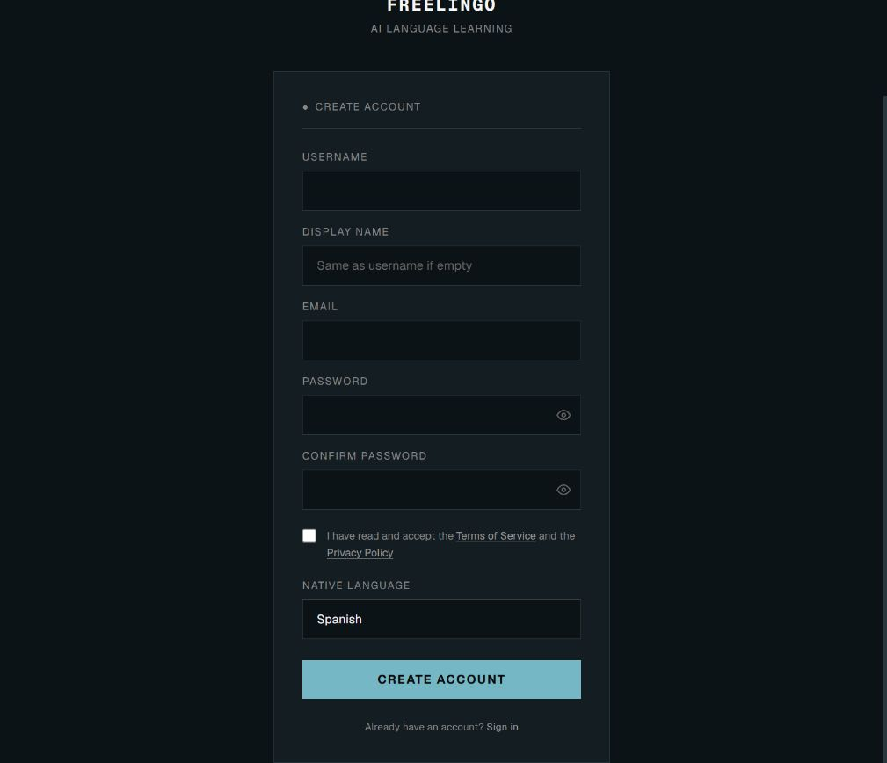
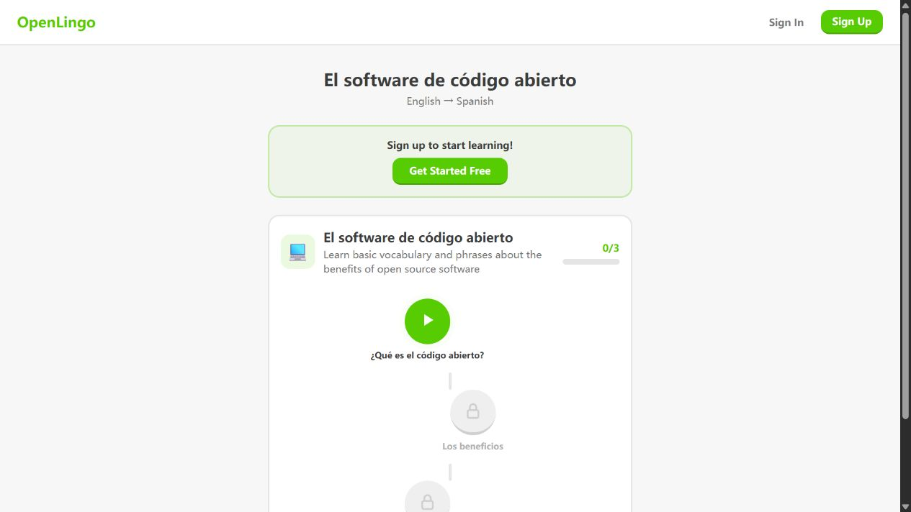

# FreeLingo 与 OpenLingo 二次开发对比

本文结论限定于这两个项目。用户进一步明确成人、系统课程及职场／技术／生活主线后，已扩大候选与内容调查，参见[成人学习底座与课程体系调研](成人学习底座与课程体系调研.md)；不能把本文的两者排序解释为全体候选的最终选型。

当前定制学习交互的前端建议统一见[架构总览第 8 节](../总览.md#8-场景与中文句子专项的交互框架建议)。本文保留“直接二开这两个产品”条件下的比较，不作为已采纳技术栈，也不覆盖该条件之外的路线。

## 1. 结论与适用范围

按本项目优先考虑的代码规范、界面规格和多语言基础，**建议将 FreeLingo 作为有条件的首选二次开发底座**。它提供更完整的工程约束、视觉系统、语言隔离及学习流程。OpenLingo 更轻、使用 MIT，适合希望主要使用 TypeScript、接受补建工程和国际化基础的路线。

两者都不能直接交付“中文母语 → 默认目标语言 → 按需中文双语 → 个人观点视频稿”的产品。FreeLingo 的中文母语入口与后端校验尚未支持中文；OpenLingo 的阅读和查词辅助深度依赖英语。二者均未查到覆盖本站要求的全站双语偏好与观点作品流程。

这是基于指定范围的选型判断，不是全面代码 Review、安全审计或运行验收。技术选型仍待用户确认，没有导入候选源码或修改其业务实现。

## 2. 来源版本与证据边界

调查日期为 2026-10-17，源码按 GitHub `main` 当前提交固定：

| 项目 | 固定源码版本 | 实际界面观察 |
| --- | --- | --- |
| FreeLingo | [16942923f1e86b426044a4dace21b8af600530ea](https://github.com/ArtCC/freelingo/tree/16942923f1e86b426044a4dace21b8af600530ea) | 官网、登录、注册表单及母语选项 |
| OpenLingo | [88b1408452de56e793b5542dd372fa930dec44ce](https://github.com/pretzelai/openlingo/tree/88b1408452de56e793b5542dd372fa930dec44ce) | 官网与公开课程目录 |

源文件下载到本机研究缓存后只读分析，未建立分支或 worktree。核查重点为工程配置、组件与主题、语言偏好、相关前后端校验、阅读辅助、语言切换和直接相关测试；没有逐行分析全部课程资料、商业支付、后台、语音流水线和所有数据库对象。

线上部署没有公开与源码提交一一对应的版本证明。公开界面和固定源码分别作为证据，不能假定它们完全同版本。两站完整练习都需要登录，本轮没有注册账号、提交练习、调用外部模型、录音或进行本地安装运行。登录后的功能由源码核对，尚未实际操作验收。

## 3. 工程规范：FreeLingo 更完整，但不能等同于代码质量无问题

| 维度 | FreeLingo | OpenLingo |
| --- | --- | --- |
| 分层 | Next.js 前端，FastAPI 的 routers/services/models/schemas，独立语言状态及接口客户端 | Next.js 页面、Server Actions、API、数据库访问、内容解析与 AI 工具集中在同一 TypeScript 应用 |
| 类型与静态规则 | TypeScript strict；Next ESLint；Prettier 与 Tailwind 类排序；后端 Ruff、Black 配置 | TypeScript strict；Next 默认 ESLint 配置；所查主应用未见统一 Prettier 配置 |
| 测试入口 | 前端 Vitest、后端 Pytest，CI 执行 lint、类型检查、测试与迁移检查 | 主应用有两个 Bun 测试文件，覆盖相似度和内容解析；package.json 未列 test 脚本，所查固定树未见 GitHub Actions 工作流 |
| 相关测试内容 | 包含语言切换、请求失效、认证会话变化、旧请求结果隔离等测试 | 已查测试集中在工具函数和解析器，未见主应用的界面、双语或语言切换回归体系 |
| 规格资料 | specs 中有前后端、语言、学习资源、测试等规格 | 有 Markdown 练习语法、提示词及功能讨论记录，未见同等覆盖的统一界面与国际化规格 |
| 维护成本 | 产品模块多，含支付、订阅、后台、语音和三维形象等，个人站需控制改动范围 | 主流程较少，主要为对话、课程、阅读、词汇、设置，理解入口更直接 |

FreeLingo 并非所有规则都严格开启：前端 ESLint 关闭了 `no-explicit-any` 和 `set-state-in-effect`；已查看的 develop PR 工作流没有执行 Ruff/Black。因此应区分“存在配置”“CI 实际执行”和“本轮运行通过”。本轮没有运行这些检查。

固定树中，FreeLingo 有 102 个前端 `*.test.ts/tsx` 文件和 78 个后端 `test_*.py` 文件；OpenLingo 主应用有两个 `*.test.ts` 文件。数量只说明已有测试资产，不能换算覆盖率或正确性。FreeLingo 配置的后端覆盖率门槛为 70%，不代表当前实测覆盖率。

FreeLingo 也存在较大逻辑集中：课程页面约 1404 行、语音会话组件约 1397 行。OpenLingo 的词汇浏览组件约 776 行、AI 工具文件约 615 行。若二开涉及这些区域，应按需求理解边界，不能因已有规范就把它们视为简单改配置。

主要依据：

- FreeLingo：[PR 检查](https://github.com/ArtCC/freelingo/blob/16942923f1e86b426044a4dace21b8af600530ea/.github/workflows/pr-develop-checks.yml)、[前端配置](https://github.com/ArtCC/freelingo/blob/16942923f1e86b426044a4dace21b8af600530ea/frontend/package.json)、[ESLint](https://github.com/ArtCC/freelingo/blob/16942923f1e86b426044a4dace21b8af600530ea/frontend/eslint.config.mjs)、[后端规范](https://github.com/ArtCC/freelingo/blob/16942923f1e86b426044a4dace21b8af600530ea/backend/pyproject.toml)。
- OpenLingo：[工程配置](https://github.com/pretzelai/openlingo/blob/88b1408452de56e793b5542dd372fa930dec44ce/package.json)、[ESLint](https://github.com/pretzelai/openlingo/blob/88b1408452de56e793b5542dd372fa930dec44ce/eslint.config.mjs)、[相似度测试](https://github.com/pretzelai/openlingo/blob/88b1408452de56e793b5542dd372fa930dec44ce/lib/similarity.test.ts)、[解析测试](https://github.com/pretzelai/openlingo/blob/88b1408452de56e793b5542dd372fa930dec44ce/lib/content/parser.test.ts)。

## 4. 界面规格与实际观感

FreeLingo 的前端规格明确配色、字体、主题变量、目标语言字体、基础组件、桌面与移动导航，以及可见文案的国际化要求。源码的 `fl-*` 语义变量、Sans/Mono 字体职责、明暗主题和 Base UI/shadcn 组件提供可复用基础。

线上注册页呈现深色底、蓝色主操作、直角表单、细分标签，与源码的视觉约定大体一致。这一页的辅助标签字号较小、视觉较弱；适配个人长期阅读时应重点核实际可读性。该观察不构成全站可访问性审计。

OpenLingo 有 `lingo-*` 颜色变量、自定义 Button 的主次/危险等变体和尺寸，以及导航和课程路径组件，不是完全没有统一样式。公开课程呈现白底、绿色按钮、圆角卡片和关卡式路径。它提供一个现成视觉起点，但所查资料中没有与 FreeLingo 等量的跨页面交互、国际化及状态规格。

视觉上，FreeLingo 更接近学习工具，OpenLingo 更偏游戏化课程；这是对已观察页面的判断，不代表登录后全部页面，也不代表已完成本站界面设计。两者的课程、对话框都不能直接代替观点草稿与视频稿编辑工作台。

依据：[FreeLingo 前端规格](https://github.com/ArtCC/freelingo/blob/16942923f1e86b426044a4dace21b8af600530ea/specs/architecture-frontend.instructions.md)、[FreeLingo 主题](https://github.com/ArtCC/freelingo/blob/16942923f1e86b426044a4dace21b8af600530ea/frontend/src/app/globals.css)、[OpenLingo 主题](https://github.com/pretzelai/openlingo/blob/88b1408452de56e793b5542dd372fa930dec44ce/app/globals.css)、[OpenLingo 按钮](https://github.com/pretzelai/openlingo/blob/88b1408452de56e793b5542dd372fa930dec44ce/components/ui/button.tsx)。

### 线上界面证据

FreeLingo 注册页：正常母语下拉列表包含 15 种语言，未包含中文。截图展示的是表单；缺少中文由现场选项文本与源码名单共同确认，不能只从折叠控件截图推断。

OpenLingo 公开课程目录：实际显示西班牙语课程标题、英文说明和英语导航；练习入口导向注册，未进入练习答题。

[FreeLingo 初始注册页截图](freelingo-register.png)和[OpenLingo 官网截图](openlingo-home.png)作为辅助界面证据保存。官网内嵌演示的视频封面不能作为本轮登录后实际操作证据。

## 5. 多语言：需要分清三个独立对象

学习语言决定练习什么，界面语言决定导航与按钮如何显示，母语决定解释和对照使用什么语言。本站要求三者能协作，但不能将“支持中文学习”解释成“已经支持中文母语辅助”。

### FreeLingo

已具备 `target_language`、`native_language` 和 `ui_locale` 的分离，界面使用 next-intl。学习语言有英美英语与德语等；语言状态通过 `/api/languages` 和 `/api/languages/active` 管理，计划、进度以用户学习语言及计划归属。前端还有切换锁、请求版本与会话版本，避免旧响应覆盖新语言上下文。

但中文存在明确缺口：

1. 注册页面的母语名单不含 `zh`，默认值为西班牙语。
2. 设置页母语名单也不含中文。
3. 后端注册与个人资料校验的 `SUPPORTED_LANGUAGES` 不含 `zh`；向注册或修改资料传中文也会被校验拒绝，这是静态代码结论，本轮未发送该请求。
4. 中文 `zh-CN` 仅列在学习目标语言集合中。界面语言 15 项也不含中文。

因此，中文母语能力不是只补一份界面翻译：需要联动前端选项、后端校验、母语名称/提示/反馈及相关测试。另需定义学习语言与界面语言的联动；原规格明确切换学习语言不能改变界面语言，故切换德语后不会自动成为德语导航。

依据：[注册页](https://github.com/ArtCC/freelingo/blob/16942923f1e86b426044a4dace21b8af600530ea/frontend/src/app/%28auth%29/register/page.tsx#L14)、[后端语言校验](https://github.com/ArtCC/freelingo/blob/16942923f1e86b426044a4dace21b8af600530ea/backend/app/schemas/auth.py#L21)、[界面语言](https://github.com/ArtCC/freelingo/blob/16942923f1e86b426044a4dace21b8af600530ea/frontend/src/lib/locales.ts#L5)、[语言状态](https://github.com/ArtCC/freelingo/blob/16942923f1e86b426044a4dace21b8af600530ea/frontend/src/store/language.ts#L138)。

### OpenLingo

引导和设置允许选择中文母语及英语/德语学习目标；偏好保存到用户配置，对话接口确实将母语传入系统提示词。这证明中文不是只有一个展示标签。

但多语言能力没有贯彻到全站：导航、设置、错误和按钮文案大量直接写英文，没有查到主应用的完整界面 locale/message 体系。课程和词汇有语言字段，但全局学习统计并非等同于 FreeLingo 的每语言学习计划模型，不能声称切换后全部统计已经按语言隔离。

阅读辅助和字典仍以英语为中心。因而“中文母语 + 德语目标”的设置不能保证阅读和查词返回中文。

依据：[引导表单](https://github.com/pretzelai/openlingo/blob/88b1408452de56e793b5542dd372fa930dec44ce/components/onboarding/onboarding-form.tsx#L17)、[导航文案](https://github.com/pretzelai/openlingo/blob/88b1408452de56e793b5542dd372fa930dec44ce/components/layout/sidebar.tsx)、[对话母语参数](https://github.com/pretzelai/openlingo/blob/88b1408452de56e793b5542dd372fa930dec44ce/app/api/chat/route.ts#L46)、[偏好与数据结构](https://github.com/pretzelai/openlingo/blob/88b1408452de56e793b5542dd372fa930dec44ce/lib/db/schema.ts#L80)。

## 6. 双语模式：两者都不满足本站的统一开关

| 要求 | FreeLingo 现状 | OpenLingo 现状 |
| --- | --- | --- |
| 默认只看目标语言内容 | 主要内容使用目标语言，但 A1/A2 的课程/语法母语帮助默认展开，答题反馈也可能直接显示已存在的母语解释 | 阅读 `viewMode` 初始为 target，但界面固定英语，课程说明语法中也约定英文描述 |
| 勾选中文双语 | 多个页面有局部母语提示或解释开关，未查到全站统一、持久化的双语偏好 | 阅读有 target / bridge / source 三种互斥视图，未查到全站中文对照开关 |
| 对照使用用户母语 | 母语帮助生成链已经存在，但中文母语尚未接入 | bridge 的 UI 标签和生成提示词都固定 English，未使用当前母语 |
| 英语与德语一致生效 | 需要统一各页面的显示策略及中文母语支持 | 需要将英文中介语、字典、缓存和界面国际化一并改造 |

FreeLingo 场景：用户关闭母语帮助后进入另一节 A1 课程，页面加载又按 CEFR 等级设置展开状态；这不等于用户可持久选择“只看英语”。需要统一偏好和各页面渲染规则，而不是仅加一个顶栏按钮。

OpenLingo 场景：中文母语用户阅读德语文章，点击 bridge，代码仍请求并显示英文中介译文。source 表示文章原始语言，也不能当作中文母语译文；英文原文的 source 仍是英文。三个视图是切换展示，不是逐句并排双语。

OpenLingo 的词典 schema 有 `englishTranslation`，查词输出要求 English translation；缓存唯一键只包含词和学习语言。若将结果改成不同母语解释，还需更新提示参数、返回结构、缓存维度和既有数据兼容，不能只改按钮名。

依据：[FreeLingo 课程初始帮助状态](https://github.com/ArtCC/freelingo/blob/16942923f1e86b426044a4dace21b8af600530ea/frontend/src/app/%28app%29/lesson/%5Bid%5D/page.tsx#L179)、[OpenLingo 阅读模式](https://github.com/pretzelai/openlingo/blob/88b1408452de56e793b5542dd372fa930dec44ce/components/article/view-mode-toggle.tsx#L17)、[阅读初始模式](https://github.com/pretzelai/openlingo/blob/88b1408452de56e793b5542dd372fa930dec44ce/components/article/translated-text.tsx#L231)、[英文中介生成](https://github.com/pretzelai/openlingo/blob/88b1408452de56e793b5542dd372fa930dec44ce/lib/article/translate.ts#L50)、[查词](https://github.com/pretzelai/openlingo/blob/88b1408452de56e793b5542dd372fa930dec44ce/lib/words.ts)、[缓存结构](https://github.com/pretzelai/openlingo/blob/88b1408452de56e793b5542dd372fa930dec44ce/lib/db/schema.ts#L216)。

## 7. 直接二次开发的建议范围

### 推荐路线：保留 FreeLingo 原有前后端，补齐个人表达流程

建议复用语言计划/进度隔离、目标语言文本组件、语法与词汇材料、课程练习和语音入口；先完成以下依赖链：

1. 补中文母语的前后端契约与反馈，明确界面语言跟随学习语言的产品规则。
2. 建立统一、可保存的双语偏好，并使课程、语法、词汇、对话及作品遵守同一显示策略。
3. 增加个人观点工作台，区分中文原稿、表达结构、外语候选与用户采纳作品，再形成口述稿。
4. 在授权范围内适配个人学习首页和相关导航，明确哪些订阅、管理、排行榜或形象功能不进入主要学习流程；不先删除底层模块。

若选择直接二开，应先保留 Next.js/FastAPI；立即改成 Vue/Spring Boot 会把复用任务变成迁移，不是本轮推荐的最小路线。是否接受该技术栈和 AGPL-3.0 仍由用户决定，尚未授权实施。

### 备选路线：OpenLingo 的轻量与 MIT 优先

适合希望主要维护 TypeScript、重点做自由主题生成和阅读练习的情况。可复用对话、Markdown 单元与练习解析、阅读和词汇功能，但需补建：界面国际化、统一双语状态、中文辅助与字典缓存、相关测试与 CI，以及个人观点作品模型。

它已有可编辑提示词和记忆，比固定课程更便于尝试自己的话题；但当前 AI `createUnit` 会解析并直接存学习单元，不能把该动作当作“用户已采纳个人观点”。需要单独建立候选到正式作品的边界。FreeLingo 同样没有在本轮范围内证明具备该作品流程。

许可证事实按固定仓库为 FreeLingo AGPL-3.0、OpenLingo MIT。若后续复制代码、公开服务或改变分发方式，应依据采用版本的许可处理；本轮没有合并代码，也不将个人使用扩展成已批准的商业化方案。

## 8. 剩余验证与决策

完整学习页、设置保存、语言切换、真实中文解释、语音和模型质量尚未运行验证。后续需要在用户已有登录状态或获授权的本地环境中完成真实流程，不能以这份静态分析宣称产品已可用。

下一步关键决定是：是否接受 FreeLingo 原技术栈与许可、是否仍以工程与界面规范为第一优先，以及先验证哪一个真实学习场景。选择与安装、运行、模型调用、开发和 Git 交付分别核授权，不因生成本报告自动进入实施。
