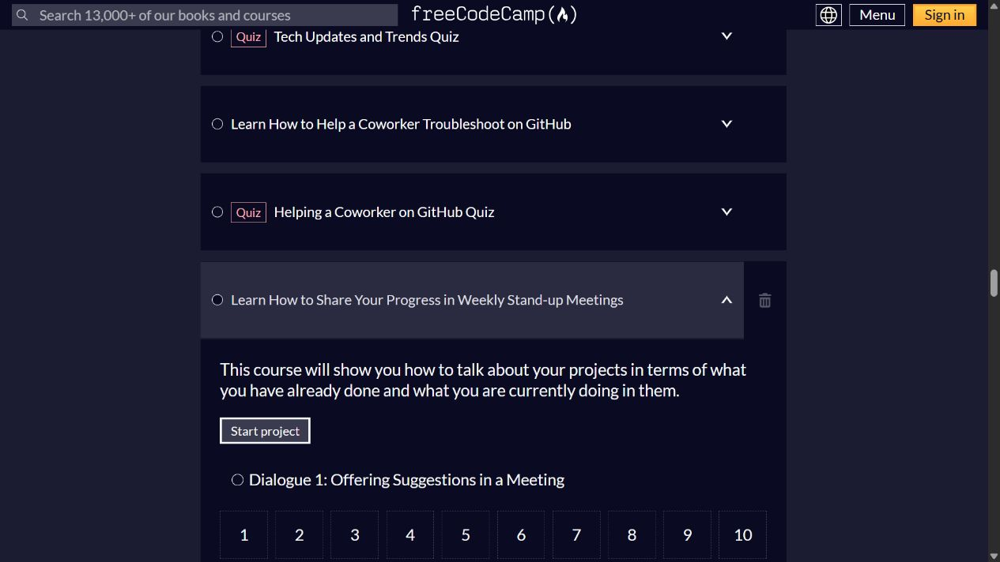
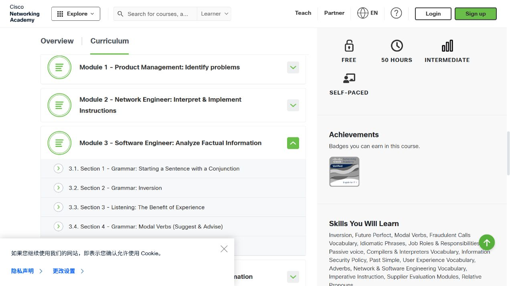
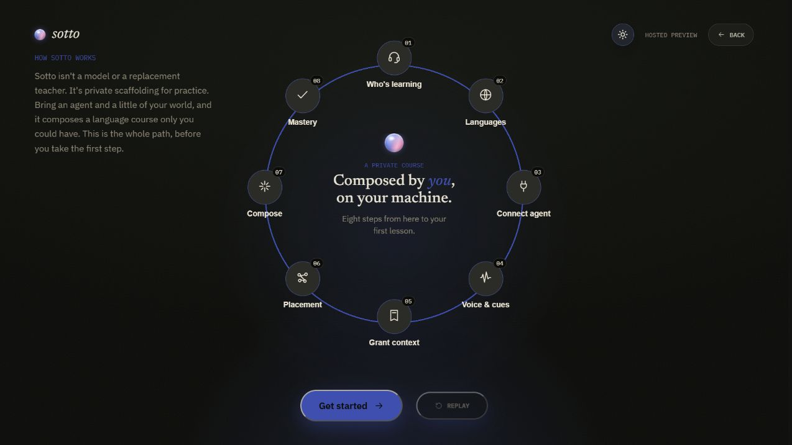

# 成人学习底座与课程体系调研

## 1. 结论与选型范围

用户明确需要面向成人、成体系、主要覆盖职场、技术和生活交流的个人学习网站；同时保留英语优先、德语扩展、中文母语、默认目标语言、可勾选中文双语，以及个人观点到视频口述稿的目标。需求以[产品总览](../../10产品/总览.md)为准。

按这一标准，建议把“课程内容体系”和“可二开的软件底座”分别选择。在本文覆盖的技术课程中，freeCodeCamp 开发者英语最值得参考；整站二开的重点候选为 Sotto 与 FreeLingo。Frappe Learning 适合另一条路线：先搭建可维护的自编课程，再建设语言训练。以上是调查建议，尚未确定技术栈或授权实施。

用户已明确从基本词句起步，采用场景教学＋专项训练，不专门背词，按发生概率和实用性收窄范围；教材现优先国外出版社较新的原版，版次及完整性统一见[教材知识库](../../10产品/10学习资料/原版教材知识库.md)。本专题保留对候选的事实调查；当前内容取舍见[课程规划](../../10产品/课程与练习规划.md)，面向定制交互的 Nuxt UI 路线见[架构总览](../总览.md)。下列 B1／技术专项资料不作为初学者入门前置，广泛主题清单也不作为首版建设范围。

成人学习的关键不在于去掉卡通形象或添加商务单词，而在于：学习什么、如何递进、何时练习、怎样判断能独立表达，以及如何把学过的内容迁移到自己的工作和生活。背词、跟读、翻译和自由聊天可以成为辅助模块，不能单独承担这一主线。

## 2. 优先参考的课程体系

| 来源 | 核实到的组织方式与内容 | 对本站的价值 | 边界 |
| --- | --- | --- | --- |
| [freeCodeCamp A2 English for Developers](https://www.freecodecamp.org/learn/a2-english-for-developers/)；[B1](https://www.freecodecamp.org/learn/b1-english-for-developers/) | A2 公开页面有主题单元、对话任务和测验；涉及入职、日常交谈、远程协作、工作职责、需求澄清、技术趋势、GitHub 排错和站会进度表达 | 最贴近“成年人＋程序员＋职场和生活”的课程结构参考；把语言知识放入持续出现的工作人物与情境 | 本轮实际展开观察的是 A2 目录及站会单元，未完成整门课；页面仍标 Beta。B1 已核入口，未逐单元验收。不能直接把整套编程教学平台当作轻量个人语言网站 |
| [Cisco English for IT 1](https://www.netacad.com/courses/english-for-it1)；[IT 2](https://www.netacad.com/courses/english-for-it2) | 以产品、网络、软件、支持、安全等岗位情境组织；听读材料配语言练习。IT 1 展开的软件工程模块涉及建议表达，以及编译器和解释器的阅读 | 技术沟通与职场语言的专业课程外链；适合已有基础后的专项训练 | IT 1 详细介绍说明 B1 入门、向 B1+ 发展；页面头部另有 B2 标示，不能据此把课程描述成零基础。未登录或完成练习；没有查到允许复制课程的开源授权 |
| [British Council Business English](https://learnenglish.britishcouncil.org/free-resources/business) | 成人商务沟通材料与主题练习 | 为会议、邮件、面试等非程序员专属职场场景提供参考 | 作为来源链接；本站的教学顺序、中文辅助和个人输出仍需组织，不将网页合集视为完整个人课程 |
| [Google Technical Writing One](https://developers.google.com/tech-writing/one) | 围绕清楚表达、术语、句子、段落及读者组织技术写作训练 | 技术解释和观点组织参考，可支持“把复杂意思说清楚” | 重点是技术写作，不能替代生活口语、发音和互动会话课程 |
| [Goethe Deutsch am Arbeitsplatz](https://www.goethe.de/de/m/spr/ueb/daa.html) | 面向工作交流的德语材料，覆盖不同难度和职业情境 | 为第二语言保留同样的成人工作场景方向 | 本轮以官方内容范围为依据，未逐课体验；英语课程不能只换语言标签就变成德语课程 |

freeCodeCamp 根仓库 `LICENSE.md` 为 BSD 3-Clause。本轮核对了根许可和课程结构索引，未完成逐项内容许可盘点；若导入具体课程文字、插图、音视频，须分别核对路径内声明和外部素材来源。Cisco 等外部课程本轮仅作为参考链接，不提出整库复制方案。

### 实际公开界面证据

以下为本轮打开公开课程、展开单元后保存的截图。它们证明页面呈现与内容组织，不证明已完成学习或取得相应能力。

freeCodeCamp：GitHub 排错主题之后衔接每周站会进度，展开后进入会议建议对话及分步任务。这种课程组织比把技术单词单独堆成词表更接近本站目标。

Cisco：软件工程模块把语言点与技术概念材料组合在一起。

## 3. 软件底座：重点候选

| 维度 | Sotto | FreeLingo | Frappe Learning |
| --- | --- | --- | --- |
| 核心组织 | 测评、课程生成、听说读写练习、反馈、掌握度和复习 | 等级课程、计划、语法词汇与听读写等练习、复习和语音 | 课程、章节、课时、学习路径、作业、测验和进度 |
| 成人职场适配 | 可把职业、兴趣、笔记和资料作为上下文；仍需建设与检验实际课程 | 有系统通用课程，但并非现成的程序员职场课程体系 | 可由站点作者稳定编排成人课程；不自带英语教学内容 |
| 工程证据 | Next.js、TypeScript、Prisma；package 有 lint、类型、Vitest、构建和 ci；GitHub CI 调用检查工作流 | 前后端分层与规格、类型检查、Vitest/Pytest 和 CI 更系统；细节见两项目专题 | Python/Frappe＋Vue/Frappe UI；已查前端 package、pyproject 和官方课程层级文档，尚未做同等深度的全仓规范调查 |
| 界面规格 | 全局样式明确设计系统，提供语义颜色、主题、字体和 480/768/1024/1280 断点；公开引导风格简洁 | 前端规格明确主题、组件、字体和布局；适合评估长期阅读体验 | 有 Frappe UI 基础组件；课程产品页面可参考官方文档，未验证其完整交互与双语状态规格 |
| 多语言 | 源码有中、英、德语言映射；课程的母语、目标语言与界面翻译覆盖须分开核 | 多种目标语言，但当前前后端中文母语校验不支持中文 | 界面本地化和同一课时的中外对照是两件事；本站语言内容模型待核／补建 |
| 双语缺口 | A2 起课程语言策略禁止生成母语解释；不等同于用户随时开启中文对照 | 未查到满足本站规则的统一开关；低等级有自动母语辅助 | 未验证原生满足用户可控双语；需专门实现或扩展 |
| 运行负担 | PostgreSQL、Redis、后台任务和模型／语音能力，组合较重 | Next.js＋FastAPI 等，现有商业化及其他模块增加理解范围 | 依赖 Frappe 生态；教学管理能力对个人站可能过重 |
| 许可声明 | AGPL-3.0 | AGPL-3.0 | AGPL-3.0 |
| 当前建议 | 更重视个人化、连贯练习闭环时重点评估 | 更重视既有规格与前后端工程体系时重点评估 | 更重视人工编排、稳定课程资产时作为替代路线 |

这三者尚无一个经过验证、可以直接满足本站全部要求。特别是中文辅助和观点作品流程，不能按“支持多语言”直接判定可用。

### Sotto：结构完整，但需区分课程框架与课程质量

源码 `curriculum-generator.ts` 说明已有少数语言对的人工参考课程，其他母语／目标语言组合按需调用模型生成 CEFR 课程骨架，并按语言对共享缓存；部分高等级还需扩展生成。中文到英语不能被描述成已有完整、经过人工校验的职场课程。

`class-language-policy.ts` 中，A2 及以上要求学习者可见课程字段全部使用目标语言，翻译字段也改为目标语言释义。具体后果是：用户到了 A2，即使想勾选中文解释，原有生成策略仍不会提供对应中文。二开须把用户显示偏好与课程生成、辅助内容和缓存机制一起核对，不能只补一个前端勾选框。

公开 `welcome` 页面已观察到个人资料、语言、模型、语音、上下文、测评、课程编排和掌握度等阶段。该页面是托管预览；本轮没有建立用户资料、配置模型或完成真实课程。它证明设计方向，不能替代实际练习验收。

主要源码依据：

- [课程生成](https://github.com/affromero/Sotto/blob/793bfe0fce7d795e16ef40f38c7d6462c727d18d/apps/web/src/lib/curriculum-generator.ts)、[课程语言策略](https://github.com/affromero/Sotto/blob/793bfe0fce7d795e16ef40f38c7d6462c727d18d/apps/web/src/lib/classes/class-language-policy.ts)。
- [设计变量与断点](https://github.com/affromero/Sotto/blob/793bfe0fce7d795e16ef40f38c7d6462c727d18d/apps/web/src/styles/globals.css)、[工程检查入口](https://github.com/affromero/Sotto/blob/793bfe0fce7d795e16ef40f38c7d6462c727d18d/apps/web/package.json)、[CI](https://github.com/affromero/Sotto/blob/793bfe0fce7d795e16ef40f38c7d6462c727d18d/.github/workflows/ci.yml)。
- [用户流程](https://github.com/affromero/Sotto/blob/793bfe0fce7d795e16ef40f38c7d6462c727d18d/docs/06-user-flows.md)。

### FreeLingo 与 Frappe 的适用差异

FreeLingo 已有通用等级课程，A2 源码以语法点、词汇集、课型、能力清单和前置单元组织。它提供学习结构，但“过去经历、未来计划、比较”等通用单元还需落到具体成人任务，例如回顾故障、说明迭代计划、比较技术方案。不能因为有等级课程，就声称已有本站需要的完整职场与技术主线。详细工程与中文缺口见[原对比](FreeLingo与OpenLingo对比.md)。

Frappe Learning 的强项是人工编排和维护课程，而非即时生成英语练习。若本站未来重视长期积累自己的稳定教材，它的课程／章节／课时／学习路径模型值得参考；但需要另做语言学习交互、双语、语音、观点及视频稿流程。其班级、评估安排等教学运营功能也未必适合个人使用。依据为[官方介绍](https://docs.frappe.io/learning/introduction)及[前端工程配置](https://github.com/frappe/lms/blob/a7d39be450f123dcbe72ec813073b70544bf956b/frontend/package.json)。

## 4. 扩大调查后降为辅助参考的项目

| 项目 | 值得借鉴 | 不列主底座的原因及证据限制 |
| --- | --- | --- |
| [LearnLang](https://github.com/CoolCoolTomato/LearnLang) | MIT；中英界面资源，母语与目标语言分离，聊天有原文／译文切换 | 定位偏陪练；本轮未查到正式课程进阶链。消息点击后用译文替换原文，约 3 秒后恢复，并非全局双语或并排对照；没有核到德语界面资源，未体验实际在线 UI |
| [Enjoy](https://github.com/ZuodaoTech/everyone-can-use-english) | 成人真实材料、听读、跟读和录音等学习方式 | 当前 README 推介新版 Web，但已查公开代码仍含 Electron 应用，不能断言新版 Web 已完整开源。根许可 GPL-3.0、子包声明 MIT，复用前需核具体范围；本轮未做完整新旧版本映射 |
| [Lector](https://github.com/heuwels/lector) | AGPL-3.0；EPUB／视频阅读、查词、复习；有 UI 组件及检查脚本 | 主要解决输入材料和词汇处理，不能独自提供成人课程主线；本轮以 README 和 package 静态核对为主 |
| [FluentRead](https://github.com/FluentRead/FluentRead) | GPL-3.0；浏览器双语阅读交互、设计系统文档及组件资产 | 是扩展工具；可研究双语呈现，不能替代课程与个人输出工作台。未把支持网页翻译等同于本站中文课程辅助 |
| [Qwerty Learner](https://github.com/RealKai42/qwerty-learner) | GPL-3.0；程序员词汇、键盘输入练习 | 即使主题是编程词汇，练习目标仍偏词汇与输入熟练，不能等同于技术交流能力或成人系统课程 |
| [OpenLingo](https://github.com/pretzelai/openlingo) | MIT；对话、阅读、词汇与公开课程路径 | 在工程规范、中文辅助及本站观点输出上仍有明显补建范围；成人专业内容未因本轮扩展调查得到验证。详见原对比 |

LearnLang 的具体双语行为依据：[消息组件](https://github.com/CoolCoolTomato/LearnLang/blob/5de537206d0e9da467269f54e68e80a4b69c7b1d/app/src/app/chat/components/message-list.tsx)及[会话提示词](https://github.com/CoolCoolTomato/LearnLang/blob/5de537206d0e9da467269f54e68e80a4b69c7b1d/api/agent/prompts/chat.go)。FluentRead 界面规格参考其[设计系统文档](https://github.com/FluentRead/FluentRead/blob/main/docs/en/guide/design-system.md)。

## 5. 调研如何用于当前课程

课程规划统一维护在[场景教学与专项训练](../../10产品/课程与练习规划.md)，本专题不再另列一套课表。当前从基本词句和少量高频任务起步，职场、技术、生活作为标签；词汇随任务使用，不设置专门背词。听说读写在场景中贯通，[中文到英文语法](../../10产品/中文表述到英文语法.md)是独立核心专项。

freeCodeCamp、Cisco 等来源用于借鉴场景组织和选择适合的参考材料，不整套照搬，不把 A2／B1 内容设为初学者前置，也不因调研出大量主题而扩大本站范围。AI 生成的结构化课程仍需核正确性、难度和衔接；本轮没有调用模型生成课程，没有把来源材料加入本站运行数据。

## 6. 来源版本与验证范围

调查日期为 2026-10-17。源码版本用于复现静态判断，公开站点未提供与这些版本一致的部署证明。

| 项目 | 固定版本 | 本轮主要证据 |
| --- | --- | --- |
| Sotto | `793bfe0fce7d795e16ef40f38c7d6462c727d18d` | 选定源码、配置、流程文档和公开引导预览 |
| LearnLang | `5de537206d0e9da467269f54e68e80a4b69c7b1d` | 选定源码、语言资源、会话与消息行为、配置 |
| Enjoy | `3d799132046993eade5a364ddd1e557906854eda` | 根说明、许可及 Electron 子包配置等 |
| Frappe Learning | `a7d39be450f123dcbe72ec813073b70544bf956b` | 根许可、前端及 Python 配置、官方文档 |
| Lector | `eb393ce925a7e6d9b8e07eac26411c1f5f7bb7b6` | README、package 与许可 |
| FluentRead | `877ee77b5e3c905f6cc016db63633342dceb2419` | README、package、许可及设计系统入口 |
| Qwerty Learner | `1182426f2bd0a28c95302c33f9e19136b1262a70` | README、package 与许可 |
| freeCodeCamp | `cee17a454280bfed51c567b774c54ad9bc5691be` | 根许可、curriculum 结构索引；另实际查看 A2 线上目录和展开单元 |

FreeLingo 和 OpenLingo 的固定版本及详细范围见原对比，不重复计作本轮完整重查。外部课程按实际访问页面取证，不声称其网站版本可由上述源码提交证明。

本轮为选型范围内的局部调查，深度不等于全仓审查：没有安装依赖、运行候选测试、启动本地应用、建立数据库、提交练习或调用模型和语音服务。公开页面截图只能证明所观察页面，不能证明掌握度算法、中文生成质量或真实学习效果。少数 GitHub API 请求遇到限流，改用已定位的公开源文件和只读版本查询；取不到的内容不写成项目没有此功能。

## 7. 仍影响最终选择的未决项

- 英语已确认从基本词句开始，A2／B1 资料需结合实际能力选用；德语水平尚未明确。
- 更偏好人工稳定课程还是高度个性化课程：决定以 Sotto／FreeLingo 语言引擎为主，还是以课程管理底座为主。
- 是否接受模型及语音服务的配置、运行复杂度和持续费用：决定个性化生成方案的可行范围。
- 首批真实任务、每次可投入时间及视频主题：决定课程拆分和输出长度；不能只因资料多就一次铺满。

这些缺口不妨碍本轮调研结论，但在确定技术栈、导入课程或进入实现前需要收敛。面向最新的少量场景与中文句子专项，当前定制前端建议为 Vue 3＋Vite＋Nuxt UI、长稿编辑按需加入 Tiptap，详见[架构总览第 8 节](../总览.md#8-场景与中文句子专项的交互框架建议)。Sotto／FreeLingo 保留为整站二开候选及流程参考；技术栈、具体课表与服务尚未采纳。
